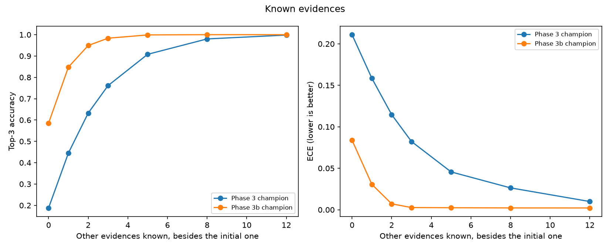
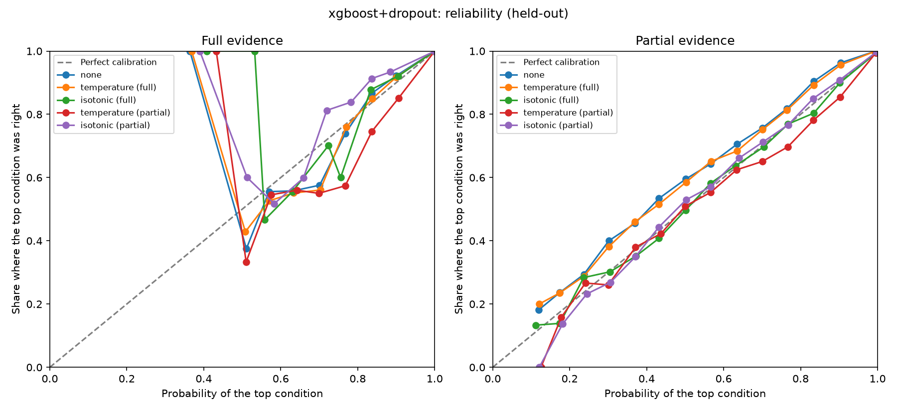
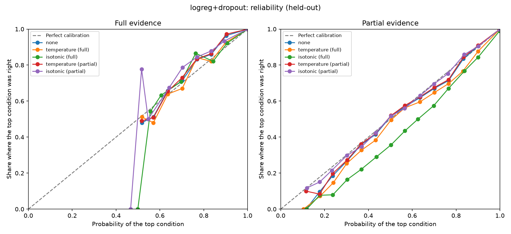

# Calibration and abstention

> BeaconAI is decision support, not diagnosis. These models are trained only on synthetic data (DDXPlus) and are not a medical device.

Generated by `make calibrate`. Do not edit by hand; the decision records are `docs/phase3_calibration.md` (Phase 3) and `docs/phase3b_dropout.md` (Phase 3b).

Data: DDXPlus full dataset, validation split. Calibrators are fit on 66,225 patients and every number below comes from the other 66,223. The test split is not used.
ECE: top-label, 15 equal-width bins. Lower is better.

Caveat: the held-out half is not fully independent of the models. Validation was already used in Phase 2 to tune hyperparameters and for early stopping, and the champion and threshold below are chosen on these same rows. Treat the numbers as somewhat optimistic until they are confirmed on the test split in the final evaluation.

Champion: **logreg+dropout + isotonic** (calibrated on partial rows), the lowest partial-evidence ECE among (model, method) pairs whose held-out top-3 accuracy is at least 0.990 on full evidence and at least 0.650 on partial evidence. Registered as `beaconai-classifier` version 13, alias `champion`.

## Partial evidence (selection basis, held-out validation)

Each patient keeps the initial evidence plus 3 other random evidences; age and sex are kept. This is closer to what a user tells us at the start of a conversation.

| Model | Method | ECE | NLL | Top-1 | Top-3 | Eligible | Calibrated on |
|---|---|---:|---:|---:|---:|---|---|
| xgboost | none | 0.5557 | 11.474 | 0.282 | 0.707 | yes | full |
| xgboost | temperature | 0.5561 | 11.516 | 0.282 | 0.707 | yes | full |
| xgboost | isotonic | 0.5770 | 16.660 | 0.284 | 0.374 | no, below the partial top-3 floor | full |
| xgboost | temperature | 0.4495 | 3.425 | 0.282 | 0.707 | yes | partial |
| xgboost | isotonic | 0.2143 | 1.869 | 0.501 | 0.745 | yes | partial |
| logreg | none | 0.0966 | 1.638 | 0.609 | 0.761 | yes | full |
| logreg | temperature | 0.0823 | 1.608 | 0.609 | 0.761 | yes | full |
| logreg | isotonic | 0.1872 | 3.958 | 0.633 | 0.798 | yes | full |
| logreg | temperature | 0.0226 | 1.527 | 0.609 | 0.761 | yes | partial |
| logreg | isotonic | 0.0948 | 0.621 | 0.831 | 0.959 | yes | partial |
| logreg+dropout | none | 0.0053 | 0.241 | 0.897 | 0.983 | yes | full |
| logreg+dropout | temperature | 0.0114 | 0.243 | 0.897 | 0.983 | yes | full |
| logreg+dropout | isotonic | 0.0343 | 0.792 | 0.878 | 0.970 | yes | full |
| logreg+dropout | temperature | 0.0053 | 0.241 | 0.897 | 0.983 | yes | partial |
| logreg+dropout | isotonic | 0.0027 | 0.251 | 0.898 | 0.983 | yes | partial |
| xgboost+dropout | none | 0.0266 | 0.245 | 0.911 | 0.989 | yes | full |
| xgboost+dropout | temperature | 0.0234 | 0.242 | 0.911 | 0.989 | yes | full |
| xgboost+dropout | isotonic | 0.0046 | 0.512 | 0.907 | 0.982 | yes | full |
| xgboost+dropout | temperature | 0.0092 | 0.225 | 0.911 | 0.989 | yes | partial |
| xgboost+dropout | isotonic | 0.0036 | 0.226 | 0.911 | 0.989 | yes | partial |

## Full evidence (comparison, held-out validation)

| Model | Method | ECE | NLL | Top-1 | Top-3 | Temperature | Calibrated on |
|---|---|---:|---:|---:|---:|---|---|
| xgboost | none | 0.0003 | 0.008 | 0.997 | 1.000 | n/a | full |
| xgboost | temperature | 0.0004 | 0.008 | 0.997 | 1.000 | 1.00 | full |
| xgboost | isotonic | 0.0004 | 0.009 | 0.997 | 1.000 | n/a | full |
| xgboost | temperature | 0.8522 | 1.944 | 0.997 | 1.000 | 7.87 | partial |
| xgboost | isotonic | 0.5074 | 0.725 | 0.996 | 0.999 | n/a | partial |
| logreg | none | 0.0004 | 0.011 | 0.996 | 1.000 | n/a | full |
| logreg | temperature | 0.0006 | 0.011 | 0.996 | 1.000 | 1.05 | full |
| logreg | isotonic | 0.0003 | 0.012 | 0.996 | 1.000 | n/a | full |
| logreg | temperature | 0.0028 | 0.012 | 0.996 | 1.000 | 1.44 | partial |
| logreg | isotonic | 0.0053 | 0.018 | 0.995 | 1.000 | n/a | partial |
| logreg+dropout | none | 0.0012 | 0.012 | 0.995 | 1.000 | n/a | full |
| logreg+dropout | temperature | 0.0008 | 0.012 | 0.995 | 1.000 | 0.88 | full |
| logreg+dropout | isotonic | 0.0006 | 0.013 | 0.995 | 1.000 | n/a | full |
| logreg+dropout | temperature | 0.0014 | 0.013 | 0.995 | 1.000 | 1.02 | partial |
| logreg+dropout | isotonic | 0.0009 | 0.013 | 0.995 | 1.000 | n/a | partial |
| xgboost+dropout | none | 0.0006 | 0.008 | 0.997 | 1.000 | n/a | full |
| xgboost+dropout | temperature | 0.0005 | 0.008 | 0.997 | 1.000 | 0.98 | full |
| xgboost+dropout | isotonic | 0.0005 | 0.010 | 0.997 | 1.000 | n/a | full |
| xgboost+dropout | temperature | 0.0013 | 0.009 | 0.997 | 1.000 | 0.71 | partial |
| xgboost+dropout | isotonic | 0.0013 | 0.017 | 0.997 | 1.000 | n/a | partial |

## Limitation: not asked is read as no

The models were trained on complete answers, where a missing evidence means the patient does not have it. With partial evidence, every question not asked yet is read the same way, as a "no". The table shows what that costs.

| Model | Method | Top-3 full | Top-3 partial | Drop (points) | ECE full | ECE partial | Increase |
|---|---|---:|---:|---:|---:|---:|---:|
| xgboost | none | 1.000 | 0.707 | 29.3 | 0.0003 | 0.5557 | +0.5553 |
| xgboost | temperature | 1.000 | 0.707 | 29.3 | 0.0004 | 0.5561 | +0.5557 |
| xgboost | isotonic | 1.000 | 0.374 | 62.6 | 0.0004 | 0.5770 | +0.5766 |
| xgboost | temperature | 1.000 | 0.707 | 29.3 | 0.8522 | 0.4495 | -0.4028 |
| xgboost | isotonic | 0.999 | 0.745 | 25.3 | 0.5074 | 0.2143 | -0.2931 |
| logreg | none | 1.000 | 0.761 | 23.9 | 0.0004 | 0.0966 | +0.0962 |
| logreg | temperature | 1.000 | 0.761 | 23.9 | 0.0006 | 0.0823 | +0.0816 |
| logreg | isotonic | 1.000 | 0.798 | 20.2 | 0.0003 | 0.1872 | +0.1869 |
| logreg | temperature | 1.000 | 0.761 | 23.9 | 0.0028 | 0.0226 | +0.0198 |
| logreg | isotonic | 1.000 | 0.959 | 4.0 | 0.0053 | 0.0948 | +0.0895 |
| logreg+dropout | none | 1.000 | 0.983 | 1.7 | 0.0012 | 0.0053 | +0.0041 |
| logreg+dropout | temperature | 1.000 | 0.983 | 1.7 | 0.0008 | 0.0114 | +0.0106 |
| logreg+dropout | isotonic | 1.000 | 0.970 | 3.0 | 0.0006 | 0.0343 | +0.0338 |
| logreg+dropout | temperature | 1.000 | 0.983 | 1.7 | 0.0014 | 0.0053 | +0.0039 |
| logreg+dropout | isotonic | 1.000 | 0.983 | 1.7 | 0.0009 | 0.0027 | +0.0017 |
| xgboost+dropout | none | 1.000 | 0.989 | 1.1 | 0.0006 | 0.0266 | +0.0260 |
| xgboost+dropout | temperature | 1.000 | 0.989 | 1.1 | 0.0005 | 0.0234 | +0.0229 |
| xgboost+dropout | isotonic | 1.000 | 0.982 | 1.8 | 0.0005 | 0.0046 | +0.0041 |
| xgboost+dropout | temperature | 1.000 | 0.989 | 1.1 | 0.0013 | 0.0092 | +0.0079 |
| xgboost+dropout | isotonic | 1.000 | 0.989 | 1.1 | 0.0013 | 0.0036 | +0.0024 |

For the champion, top-3 accuracy drops from 1.000 to 0.983 (1.7 points) and ECE rises from 0.0009 to 0.0027 when only the initial evidence and 3 others are known. Fixing this needs retraining (random evidence dropout, or a yes/no/not-asked encoding) before the Phase 8 question selector.

## Comparison with the Phase 3 baseline

Same held-out rows and the same partial-evidence rule as Phase 3.

| | Model | Method | Calibrated on | ECE partial | Top-3 partial | ECE full | Top-3 full |
|---|---|---|---|---:|---:|---:|---:|
| Phase 3 champion | logreg | temperature | full | 0.0823 | 0.761 | 0.0006 | 1.000 |
| Phase 3b champion | logreg+dropout | isotonic | partial | 0.0027 | 0.983 | 0.0009 | 1.000 |

Phase 3 baseline, all candidates:

| | Model | Method | Calibrated on | ECE partial | Top-3 partial | ECE full | Top-3 full |
|---|---|---|---|---:|---:|---:|---:|
| Phase 3 | xgboost | none | full | 0.5557 | 0.707 | 0.0003 | 1.000 |
| Phase 3 | xgboost | temperature | full | 0.5561 | 0.707 | 0.0004 | 1.000 |
| Phase 3 | xgboost | isotonic | full | 0.5770 | 0.374 | 0.0004 | 1.000 |
| Phase 3 | logreg | none | full | 0.0966 | 0.761 | 0.0004 | 1.000 |
| Phase 3 | logreg | temperature | full | 0.0823 | 0.761 | 0.0006 | 1.000 |
| Phase 3 | logreg | isotonic | full | 0.1872 | 0.798 | 0.0003 | 1.000 |

## Accuracy and calibration by number of known evidences

Held-out patients keep the initial evidence plus n other random evidences (same rule as the partial-evidence evaluation).

| Other evidences | Top-3 (Phase 3) | Top-3 (Phase 3b) | ECE (Phase 3) | ECE (Phase 3b) |
|---:|---:|---:|---:|---:|
| 0 | 0.188 | 0.585 | 0.2110 | 0.0839 |
| 1 | 0.445 | 0.848 | 0.1585 | 0.0306 |
| 2 | 0.633 | 0.949 | 0.1147 | 0.0071 |
| 3 | 0.761 | 0.983 | 0.0823 | 0.0027 |
| 5 | 0.908 | 0.999 | 0.0456 | 0.0024 |
| 8 | 0.980 | 1.000 | 0.0264 | 0.0022 |
| 12 | 0.998 | 1.000 | 0.0099 | 0.0021 |

## Reliability diagrams

## Abstention

Threshold: 0.60. BeaconAI abstains when the calibrated probability of the most likely condition is below this; equal is answered.

Suggested threshold: 0.60 (smallest threshold whose answered patients who know only the initial evidence plus 0 other evidences reach top-3 accuracy of 0.95).

| Evidence | Answered | Top-1 on answered | Top-3 on answered |
|---|---:|---:|---:|
| Full evidence | 99.9% | 0.995 | 1.000 |
| Partial evidence | 89.7% | 0.953 | 0.999 |
| Initial evidence + 0 | 30.1% | 0.751 | 0.953 |

