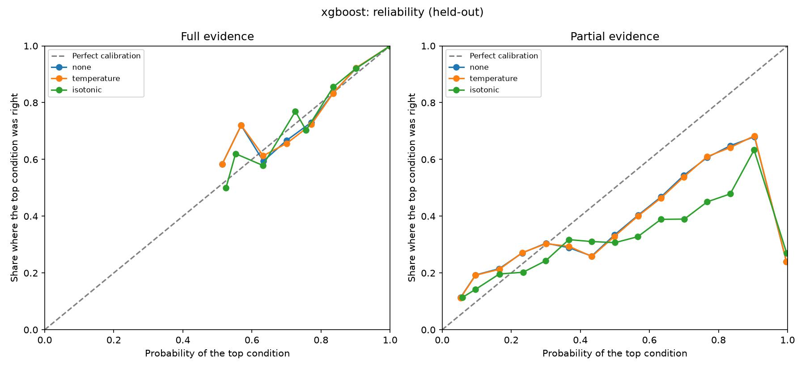
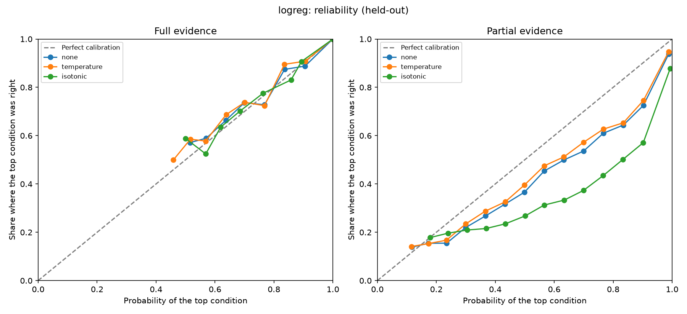
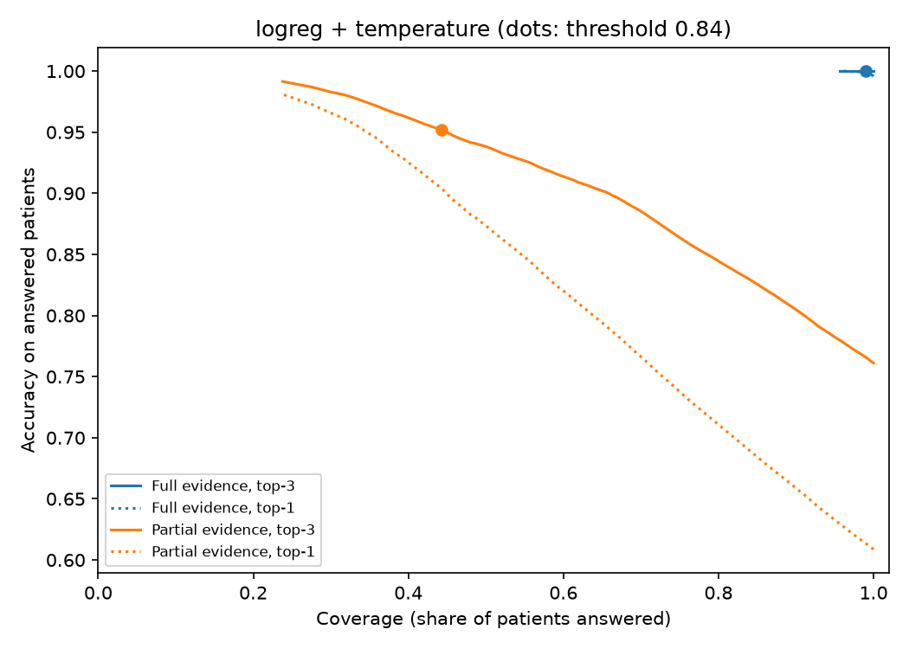

# Calibration and abstention

> BeaconAI is decision support, not diagnosis. These models are trained only on synthetic data (DDXPlus) and are not a medical device.

Generated by `make calibrate`. Do not edit by hand; the decision record is `docs/phase3_calibration.md`.

Data: DDXPlus full dataset, validation split. Calibrators are fit on 66,225 patients and every number below comes from the other 66,223. The test split is not used.
ECE: top-label, 15 equal-width bins. Lower is better.

Caveat: the held-out half is not fully independent of the models. Validation was already used in Phase 2 to tune hyperparameters and for early stopping, and the champion and threshold below are chosen on these same rows. Treat the numbers as somewhat optimistic until they are confirmed on the test split in the final evaluation.

Champion: **logreg + temperature**, the lowest partial-evidence ECE among (model, method) pairs whose held-out top-3 accuracy is at least 0.990 on full evidence and at least 0.650 on partial evidence. Registered as `beaconai-classifier` version 8, alias `champion`.

## Partial evidence (selection basis, held-out validation)

Each patient keeps the initial evidence plus 3 other random evidences; age and sex are kept. This is closer to what a user tells us at the start of a conversation.

| Model | Method | ECE | NLL | Top-1 | Top-3 | Eligible |
|---|---|---:|---:|---:|---:|---|
| xgboost | none | 0.5557 | 11.474 | 0.282 | 0.707 | yes |
| xgboost | temperature | 0.5561 | 11.516 | 0.282 | 0.707 | yes |
| xgboost | isotonic | 0.5770 | 16.660 | 0.284 | 0.374 | no, below the partial top-3 floor |
| logreg | none | 0.0966 | 1.638 | 0.609 | 0.761 | yes |
| logreg | temperature | 0.0823 | 1.608 | 0.609 | 0.761 | yes |
| logreg | isotonic | 0.1872 | 3.958 | 0.633 | 0.798 | yes |

## Full evidence (comparison, held-out validation)

| Model | Method | ECE | NLL | Top-1 | Top-3 | Temperature |
|---|---|---:|---:|---:|---:|---|
| xgboost | none | 0.0003 | 0.008 | 0.997 | 1.000 | n/a |
| xgboost | temperature | 0.0004 | 0.008 | 0.997 | 1.000 | 1.00 |
| xgboost | isotonic | 0.0004 | 0.009 | 0.997 | 1.000 | n/a |
| logreg | none | 0.0004 | 0.011 | 0.996 | 1.000 | n/a |
| logreg | temperature | 0.0006 | 0.011 | 0.996 | 1.000 | 1.05 |
| logreg | isotonic | 0.0003 | 0.012 | 0.996 | 1.000 | n/a |

## Limitation: not asked is read as no

The models were trained on complete answers, where a missing evidence means the patient does not have it. With partial evidence, every question not asked yet is read the same way, as a "no". The table shows what that costs.

| Model | Method | Top-3 full | Top-3 partial | Drop (points) | ECE full | ECE partial | Increase |
|---|---|---:|---:|---:|---:|---:|---:|
| xgboost | none | 1.000 | 0.707 | 29.3 | 0.0003 | 0.5557 | +0.5553 |
| xgboost | temperature | 1.000 | 0.707 | 29.3 | 0.0004 | 0.5561 | +0.5557 |
| xgboost | isotonic | 1.000 | 0.374 | 62.6 | 0.0004 | 0.5770 | +0.5766 |
| logreg | none | 1.000 | 0.761 | 23.9 | 0.0004 | 0.0966 | +0.0962 |
| logreg | temperature | 1.000 | 0.761 | 23.9 | 0.0006 | 0.0823 | +0.0816 |
| logreg | isotonic | 1.000 | 0.798 | 20.2 | 0.0003 | 0.1872 | +0.1869 |

For the champion, top-3 accuracy drops from 1.000 to 0.761 (23.9 points) and ECE rises from 0.0006 to 0.0823 when only the initial evidence and 3 others are known. Fixing this needs retraining (random evidence dropout, or a yes/no/not-asked encoding) before the Phase 8 question selector.

## Reliability diagrams

## Abstention

Threshold: 0.84. BeaconAI abstains when the calibrated probability of the most likely condition is below this; equal is answered.

Suggested threshold: 0.84 (smallest threshold whose answered partial-evidence patients reach top-3 accuracy of 0.95).

| Evidence | Answered | Top-1 on answered | Top-3 on answered |
|---|---:|---:|---:|
| Full evidence | 99.0% | 0.999 | 1.000 |
| Partial evidence | 44.3% | 0.904 | 0.952 |

