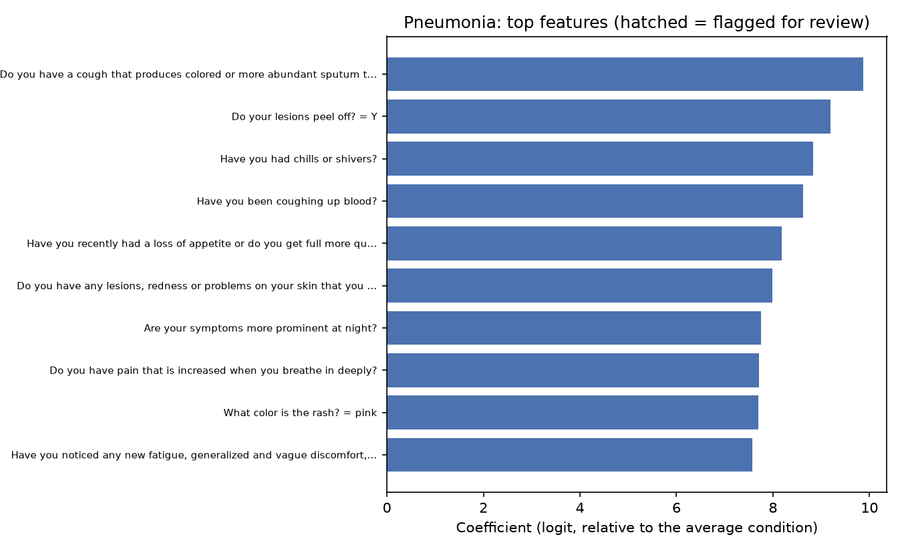
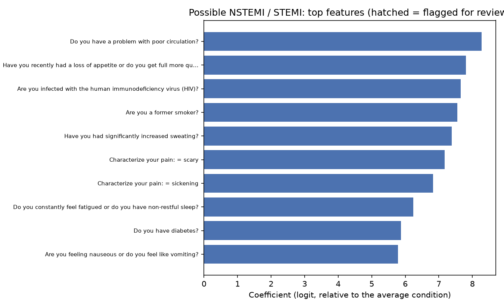
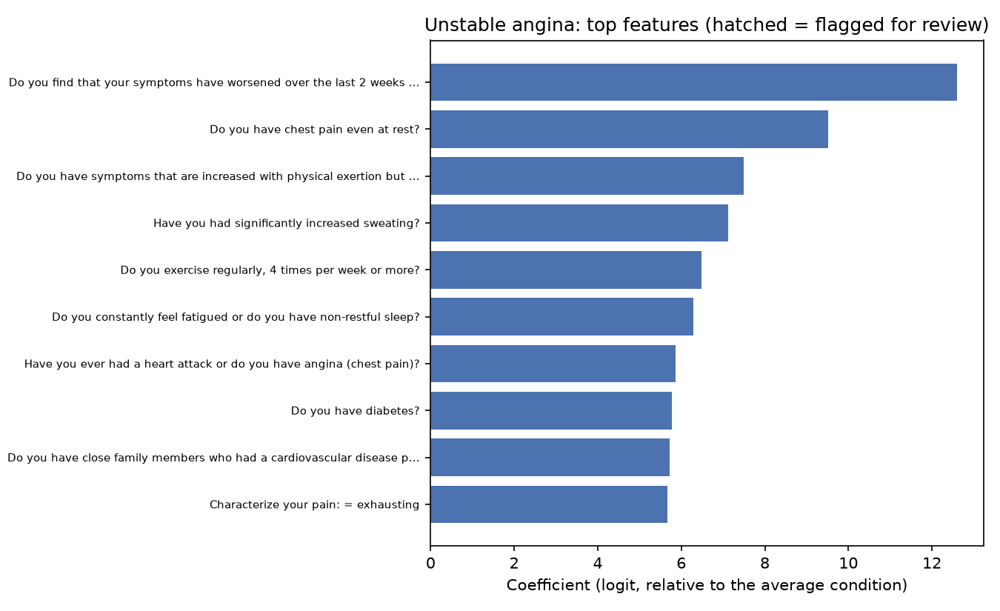
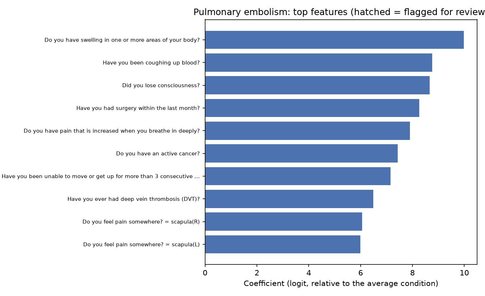
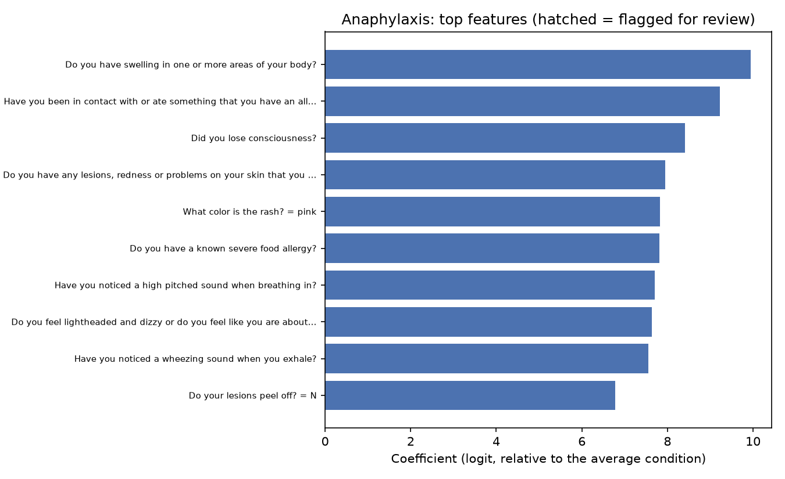
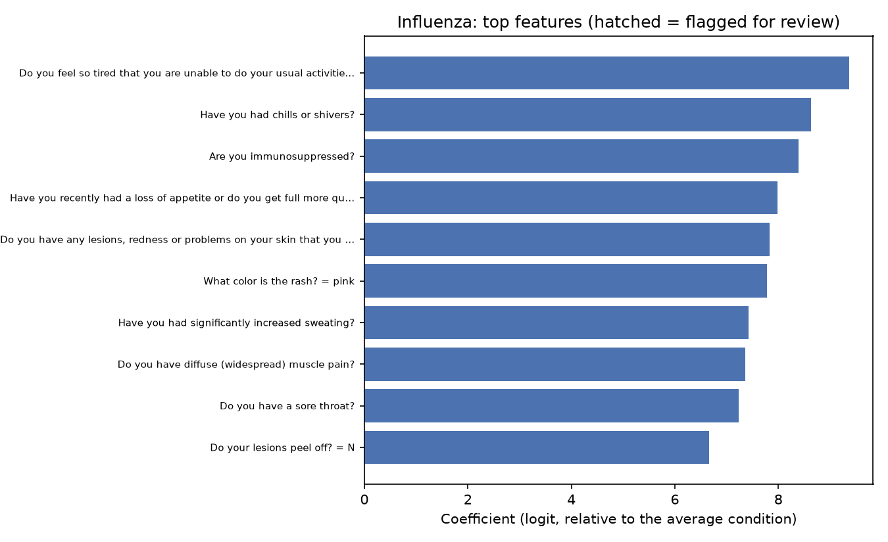
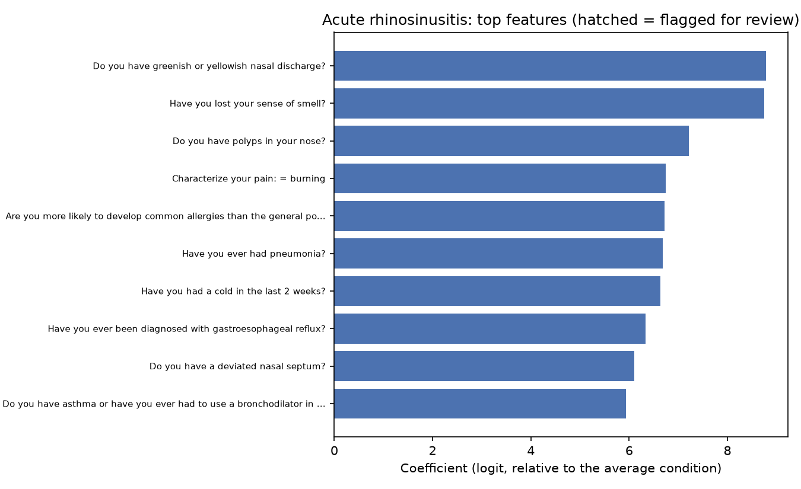
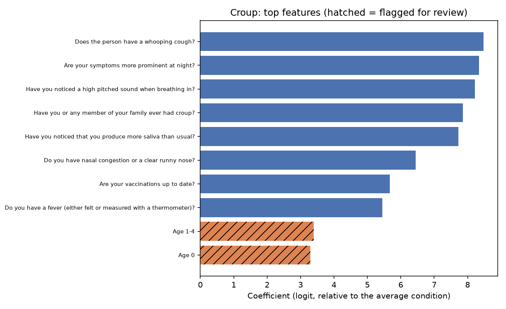

# Explainability

> BeaconAI is decision support, not diagnosis. This model is trained only on synthetic data (DDXPlus) and is not a medical device.

Generated by `make explain`. Do not edit by hand. Decision record: `docs/phase4_explainability.md`.

Model: `beaconai-classifier` version 13: logreg+dropout + isotonic (calibrated on partial). Data: DDXPlus full dataset.

## How to read these explanations

- They are exact for this linear model, in its logit space before isotonic calibration. Calibration changes the probabilities shown to the user, not these scores.
- Each contribution is measured against a baseline patient with no evidence and the training-average age and sex: average age 39.7, 49% male (from the raw train CSV (full training set), 1,025,602 patients). So a female and a male patient both get a sex contribution with the same meaning, and the baseline score plus all contributions equals the model's score exactly.
- A single-condition explanation is relative to the average condition: the model's coefficients are only defined up to a constant shared by all conditions, and the fitted ones are centered (largest per-feature mean across conditions: 0.0152).
- The most useful explanation is the contrast, why the top condition rather than the runner-up, which has no such ambiguity.

## Does calibration change the ranking?

Held-out validation patients: how often the order shown to the user (calibrated, with exact ties broken by the model's own score) differs from the model's own order.

| Evidence | Top-1 changed | Top-3 set changed | Shown set changed (conditions at 1% or more) |
|---|---:|---:|---:|
| Full evidence | 0.1% | 0.0% | 0.05% |
| Partial evidence | 1.5% | 5.6% | 4.04% |

Isotonic calibration maps many small probabilities to the same value, so most changes in the top-3 set are among conditions the user would not be shown. When the top two are flipped, the contrast says so (`ranking_changed_by_calibration`).

## Latency

End to end (encode, calibrated prediction, explanation) on 300 real validation patients: median 0.6 ms, p95 0.7 ms, within the 50 ms budget.

## Worked examples (held-out patients, partial evidence)

- BeaconAI answers. Why Panic attack rather than GERD: Do you feel like you are detached from your own body or your surroundings?: yes (+9.17), How precisely is the pain located? (0-10 scale): 7/10 (+0.15), Sex: female (training mix 49% male) (+0.03). Pointing to GERD instead: How intense is the pain? (0-10 scale): 6/10 (-0.37), Do you have asthma or have you ever had to use a bronchodilator in the past?: yes (-0.34), Age: 10 (training average 40) (-0.18). (True condition: Panic attack.)
- BeaconAI answers. Why Anaphylaxis rather than Influenza: How fast did the pain appear? (0-10 scale): 5/10 (+0.72), Age: 68 (training average 40) (+0.17), Sex: female (training mix 49% male) (+0.05). Pointing to Influenza instead: Do you have pain somewhere, related to your reason for consulting?: yes (-0.02), Does the pain radiate to another location? = nowhere (-0.01). (True condition: Influenza.)
- BeaconAI abstains. Why Boerhaave rather than GERD: Do you feel pain somewhere? = upper chest (+1.00), How fast did the pain appear? (0-10 scale): 6/10 (+0.84), Do you feel pain somewhere? = lower chest (+0.25). Pointing to GERD instead: Do you feel pain somewhere? = epigastric (-1.15), Do you feel pain somewhere? = hypochondrium(R) (-0.87), Do you have pain somewhere, related to your reason for consulting?: yes (-0.17). (True condition: Boerhaave.)

## Global view

Top features per condition by coefficient (the logit contribution when present, relative to the average condition). Prevalence is from the training split. Hatched bars are flagged for review.

### Pneumonia

| Feature | Coefficient | With condition | Overall | Flags |
|---|---:|---:|---:|---|
| Do you have a cough that produces colored or more abundant sputum than usual? | 9.868 | 85.3% | 9.6% |  |
| Do your lesions peel off? = Y | 9.198 | 99.3% | 2.5% |  |
| Have you had chills or shivers? | 8.834 | 68.8% | 3.4% |  |
| Have you been coughing up blood? | 8.624 | 52.1% | 9.8% |  |
| Have you recently had a loss of appetite or do you get full more quickly then usually? | 8.181 | 66.6% | 5.4% |  |
| Do you have any lesions, redness or problems on your skin that you believe are related to the condition you are consulting for? | 7.980 | 99.3% | 16.3% |  |
| Are your symptoms more prominent at night? | 7.752 | 57.2% | 3.1% |  |
| Do you have pain that is increased when you breathe in deeply? | 7.709 | 52.7% | 6.2% |  |
| What color is the rash? = pink | 7.694 | 99.3% | 9.3% |  |
| Have you noticed any new fatigue, generalized and vague discomfort, diffuse (widespread) muscle aches or a change in your general well-being related to your consultation today? | 7.574 | 60.5% | 4.1% |  |

### Possible NSTEMI / STEMI

| Feature | Coefficient | With condition | Overall | Flags |
|---|---:|---:|---:|---|
| Do you have a problem with poor circulation? | 8.278 | 73.2% | 1.5% |  |
| Have you recently had a loss of appetite or do you get full more quickly then usually? | 7.810 | 64.0% | 5.4% |  |
| Are you infected with the human immunodeficiency virus (HIV)? | 7.652 | 67.0% | 2.4% |  |
| Are you a former smoker? | 7.550 | 59.1% | 2.4% |  |
| Have you had significantly increased sweating? | 7.387 | 63.9% | 12.6% |  |
| Characterize your pain: = scary | 7.175 | 74.1% | 2.5% |  |
| Characterize your pain: = sickening | 6.826 | 74.3% | 4.4% |  |
| Do you constantly feel fatigued or do you have non-restful sleep? | 6.240 | 55.7% | 8.8% |  |
| Do you have diabetes? | 5.874 | 76.4% | 8.8% |  |
| Are you feeling nauseous or do you feel like vomiting? | 5.785 | 59.9% | 10.5% |  |

### Unstable angina

| Feature | Coefficient | With condition | Overall | Flags |
|---|---:|---:|---:|---|
| Do you find that your symptoms have worsened over the last 2 weeks and that progressively less effort is required to cause the symptoms? | 12.600 | 69.6% | 1.4% |  |
| Do you have chest pain even at rest? | 9.513 | 65.9% | 1.9% |  |
| Do you have symptoms that are increased with physical exertion but alleviated with rest? | 7.487 | 71.7% | 6.7% |  |
| Have you had significantly increased sweating? | 7.114 | 52.8% | 12.6% |  |
| Do you exercise regularly, 4 times per week or more? | 6.488 | 65.5% | 2.4% |  |
| Do you constantly feel fatigued or do you have non-restful sleep? | 6.281 | 54.2% | 8.8% |  |
| Have you ever had a heart attack or do you have angina (chest pain)? | 5.867 | 81.7% | 7.5% |  |
| Do you have diabetes? | 5.771 | 76.3% | 8.8% |  |
| Do you have close family members who had a cardiovascular disease problem before the age of 50? | 5.716 | 76.6% | 4.1% |  |
| Characterize your pain: = exhausting | 5.672 | 74.3% | 10.7% |  |

### Pulmonary embolism

| Feature | Coefficient | With condition | Overall | Flags |
|---|---:|---:|---:|---|
| Do you have swelling in one or more areas of your body? | 9.987 | 89.3% | 9.7% |  |
| Have you been coughing up blood? | 8.768 | 63.0% | 9.8% |  |
| Did you lose consciousness? | 8.668 | 66.8% | 3.4% |  |
| Have you had surgery within the last month? | 8.263 | 95.3% | 3.8% |  |
| Do you have pain that is increased when you breathe in deeply? | 7.902 | 72.0% | 6.2% |  |
| Do you have an active cancer? | 7.428 | 67.6% | 1.8% |  |
| Have you been unable to move or get up for more than 3 consecutive days within the last 4 weeks? | 7.155 | 61.0% | 1.6% |  |
| Have you ever had deep vein thrombosis (DVT)? | 6.491 | 66.1% | 3.3% |  |
| Do you feel pain somewhere? = scapula(R) | 6.052 | 72.8% | 2.1% |  |
| Do you feel pain somewhere? = scapula(L) | 5.996 | 72.3% | 2.1% |  |

### Anaphylaxis

| Feature | Coefficient | With condition | Overall | Flags |
|---|---:|---:|---:|---|
| Do you have swelling in one or more areas of your body? | 9.943 | 99.3% | 9.7% |  |
| Have you been in contact with or ate something that you have an allergy to? | 9.224 | 77.1% | 2.1% |  |
| Did you lose consciousness? | 8.409 | 60.0% | 3.4% |  |
| Do you have any lesions, redness or problems on your skin that you believe are related to the condition you are consulting for? | 7.944 | 100.0% | 16.3% |  |
| What color is the rash? = pink | 7.825 | 100.0% | 9.3% |  |
| Do you have a known severe food allergy? | 7.817 | 80.5% | 2.2% |  |
| Have you noticed a high pitched sound when breathing in? | 7.702 | 60.0% | 4.2% |  |
| Do you feel lightheaded and dizzy or do you feel like you are about to faint? | 7.640 | 63.1% | 8.9% |  |
| Have you noticed a wheezing sound when you exhale? | 7.549 | 59.6% | 7.2% |  |
| Do your lesions peel off? = N | 6.778 | 100.0% | 17.0% |  |

### Influenza

| Feature | Coefficient | With condition | Overall | Flags |
|---|---:|---:|---:|---|
| Do you feel so tired that you are unable to do your usual activities or are you stuck in your bed all day long? | 9.364 | 77.8% | 7.0% |  |
| Have you had chills or shivers? | 8.631 | 65.8% | 3.4% |  |
| Are you immunosuppressed? | 8.387 | 57.3% | 6.4% |  |
| Have you recently had a loss of appetite or do you get full more quickly then usually? | 7.987 | 60.6% | 5.4% |  |
| Do you have any lesions, redness or problems on your skin that you believe are related to the condition you are consulting for? | 7.831 | 86.5% | 16.3% |  |
| What color is the rash? = pink | 7.781 | 86.5% | 9.3% |  |
| Have you had significantly increased sweating? | 7.429 | 68.3% | 12.6% |  |
| Do you have diffuse (widespread) muscle pain? | 7.360 | 69.3% | 9.1% |  |
| Do you have a sore throat? | 7.232 | 54.1% | 9.2% |  |
| Do your lesions peel off? = N | 6.667 | 100.0% | 17.0% |  |

### Acute rhinosinusitis

| Feature | Coefficient | With condition | Overall | Flags |
|---|---:|---:|---:|---|
| Do you have greenish or yellowish nasal discharge? | 8.786 | 81.3% | 2.4% |  |
| Have you lost your sense of smell? | 8.750 | 74.2% | 2.7% |  |
| Do you have polyps in your nose? | 7.218 | 91.2% | 3.0% |  |
| Characterize your pain: = burning | 6.744 | 80.9% | 15.1% |  |
| Are you more likely to develop common allergies than the general population? | 6.719 | 80.8% | 7.8% |  |
| Have you ever had pneumonia? | 6.682 | 72.3% | 5.6% |  |
| Have you had a cold in the last 2 weeks? | 6.631 | 61.9% | 5.7% |  |
| Have you ever been diagnosed with gastroesophageal reflux? | 6.333 | 68.9% | 4.3% |  |
| Do you have a deviated nasal septum? | 6.103 | 69.1% | 2.3% |  |
| Do you have asthma or have you ever had to use a bronchodilator in the past? | 5.930 | 87.5% | 13.5% |  |

### Croup

| Feature | Coefficient | With condition | Overall | Flags |
|---|---:|---:|---:|---|
| Does the person have a whooping cough? | 8.474 | 72.8% | 0.2% |  |
| Are your symptoms more prominent at night? | 8.341 | 63.9% | 3.1% |  |
| Have you noticed a high pitched sound when breathing in? | 8.216 | 72.1% | 4.2% |  |
| Have you or any member of your family ever had croup? | 7.865 | 78.5% | 0.2% |  |
| Have you noticed that you produce more saliva than usual? | 7.727 | 58.7% | 1.4% |  |
| Do you have nasal congestion or a clear runny nose? | 6.441 | 65.1% | 19.8% |  |
| Are your vaccinations up to date? | 5.671 | 52.0% | 5.6% |  |
| Do you have a fever (either felt or measured with a thermometer)? | 5.442 | 59.1% | 21.1% |  |
| Age 1-4 | 3.396 | 37.2% | 3.5% | demographic |
| Age 0 | 3.294 | 17.7% | 1.7% | demographic |

## Sanity check

Automatic flags: 2 of the listed top features. A flag means: rarely seen with the condition (under the configured prevalence), less common with the condition than overall yet pushing toward it (usually collinearity), or a demographic feature. Flags are prompts for review, not errors.

## Author review of the global view

**This is an author review, not a clinical validation.** It was written by the project author from general medical knowledge, without clinician sign-off, and must not be read as evidence that the model reasons correctly in a clinical sense. It checks whether each condition's top features (in the tables above) look like the presenting symptoms and risk factors one would expect, and labels each surprise as expected, plausible, or odd, with a likely cause.

### Summary

- Six of the eight conditions are led by textbook features: pulmonary embolism, unstable angina, anaphylaxis, croup, NSTEMI/STEMI and pneumonia (for its respiratory items). The model's strongest reasons are mostly the ones a clinician would look for.
- The automatic flags caught only the croup age buckets (expected). They cannot catch the main oddity below: a feature that is genuinely common with a condition in DDXPlus, even though it is not common in real medicine. Such a feature passes every prevalence check.
- **Main oddity: skin questions.** "Do you have any lesions, redness or problems on your skin...", "What color is the rash? = pink" and "Do your lesions peel off?" rank among the top features for pneumonia (99.3% of DDXPlus pneumonia patients answer yes to the skin question) and influenza (86.5%). This looks like a quirk of how DDXPlus generated its synthetic patients, not a model error: the model is faithful to its data. It matters for users, though: an explanation such as "pink rash" for pneumonia would confuse them and undermine trust. Worth handling before explanations are shown (Phase 5 or 10), for example by reviewing which features may appear in user-facing reasons.

### By condition

| Condition | Verdict | Notes |
|---|---|---|
| Pneumonia | Mostly expected, one odd group | Expected: coloured sputum, chills, coughing up blood, pain on deep breathing, loss of appetite, fatigue, symptoms worse at night. **Odd:** the skin lesion and pink rash items (synthetic-data quirk, see above). |
| Possible NSTEMI / STEMI | Plausible, one odd | Expected: sweating, "scary" or "sickening" pain, nausea, diabetes, former smoker, poor circulation, fatigue. Chest pain itself is not in the top 10. That is plausible, because chest pain is shared with angina and other chest conditions and so does not separate them. **Odd:** HIV infection in 67% of these patients. HIV is a real cardiovascular risk factor, but this prevalence is far above any real population; a synthetic-data quirk. Loss of appetite is weak but plausible. |
| Unstable angina | Expected, one odd | Textbook: worsening over the last 2 weeks with less exertion, chest pain at rest, symptoms with exertion relieved by rest, previous heart attack or angina, diabetes, family history of early cardiovascular disease, sweating. **Odd:** "Do you exercise regularly, 4 times per week or more?" pushes toward unstable angina (66% of these patients say yes). Regular exercise is protective in real medicine, so this is probably a data-generation quirk or a question whose meaning differs from its wording. |
| Pulmonary embolism | Expected | Textbook risk factors and signs (close to the Wells criteria): swelling, recent surgery, active cancer, immobility for more than 3 days, previous deep vein thrombosis, coughing up blood, pain on deep breathing, fainting. Pain at the shoulder blades is plausible as referred pleuritic pain. |
| Anaphylaxis | Expected | Textbook: contact with a known allergen, severe food allergy, swelling, skin rash, high-pitched sound when breathing in (stridor), wheezing, light-headedness, fainting. The skin items are clinically right here. "Lesions do not peel off" is a neutral answer to a skin question. |
| Influenza | Mostly expected, one odd group | Expected: exhaustion, chills, widespread muscle pain, sore throat, sweating, loss of appetite. Being immunosuppressed is plausible as a risk factor. Fever itself is not in the top 10. That is plausible, because fever is common to many infections and so does not separate them. **Odd:** the pink rash and skin lesion items (86.5% prevalence; same quirk as pneumonia). |
| Acute rhinosinusitis | Expected core, some chronic features | Expected: green or yellow nasal discharge, loss of smell, a cold in the last 2 weeks. **Plausible but telling:** nasal polyps (91% of these patients), deviated septum, allergies and asthma are classic *chronic* rhinosinusitis risk factors. That overlap explains the main Phase 2 confusion (acute predicted as chronic, 13%). **Odd:** "burning" pain, a history of pneumonia and reflux disease are weak or unexpected for acute sinusitis. |
| Croup | Expected, one odd | Textbook: barking ("whooping") cough, symptoms worse at night, high-pitched sound when breathing in (stridor), family history of croup, runny nose, fever, and young age (the only automatic flags: age 1 to 4 and under 1, both expected). **Odd:** producing more saliva than usual is a classic sign of epiglottitis, not croup; possibly the DDXPlus definitions overlap there. Vaccinations being up to date is neutral. |

### What this means

- No feature suggests leakage or a broken model. The surprises trace back to how DDXPlus was generated, and the model reproduces them faithfully.
- The skin-question quirk affects explanation quality more than accuracy. Users should not be shown "pink rash" as a reason for pneumonia without review.
- The automatic flags are useful for catching collinearity and rare features, but they cannot replace a human (ideally clinical) review, because they only compare the model with its own data.

## Reviewer notes

<!-- For the project owner: add your notes after reading the review above. -->
