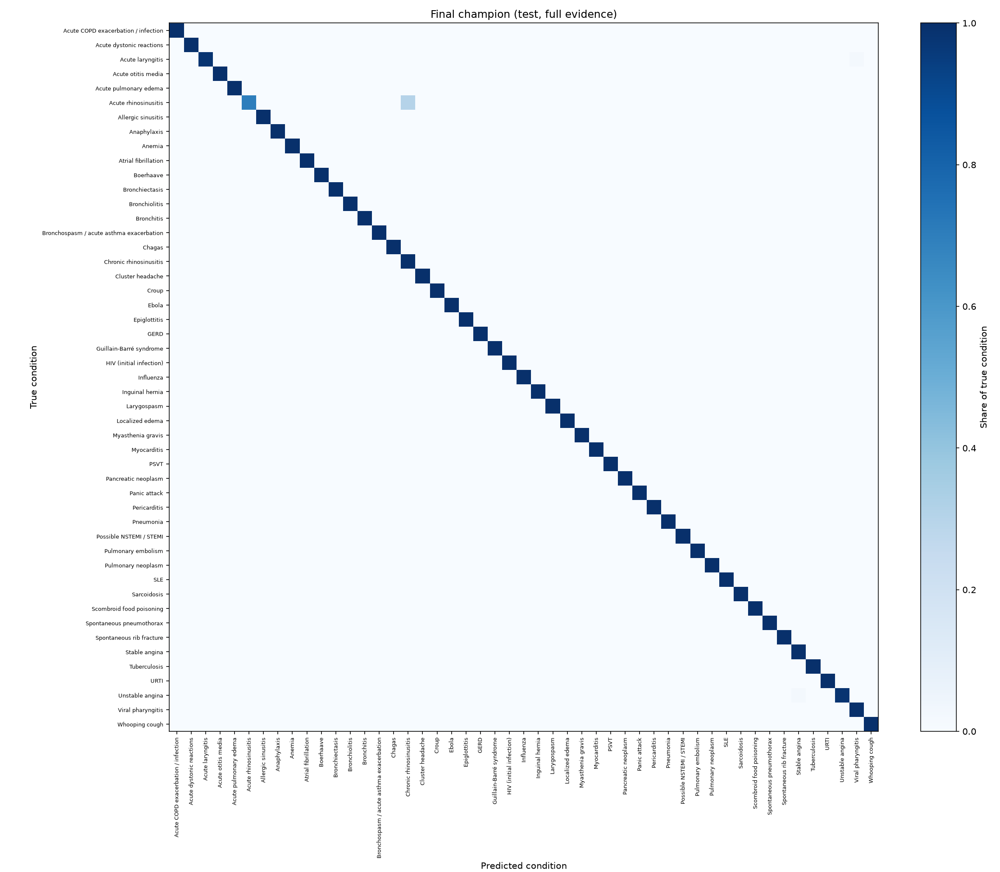

# Final test evaluation

> BeaconAI is decision support, not diagnosis. This model is trained only on synthetic data (DDXPlus) and is not a medical device.

Model: `beaconai-classifier` version 13 (alias `champion`): logreg+dropout + isotonic (calibrated on partial).
Test patients: 134,529. The test split is scored once for this evaluation; `reports/test_locks/classifier_final.json` blocks repeat scoring.
Partial evidence: each patient keeps the initial evidence plus 3 other random evidences, the same rule used on validation.

**Any classifier change after this point is validated on validation data only.** These test numbers describe this model version and are not re-measured.

## Accuracy and calibration

| Evidence | Top-1 | Top-3 | Top-5 | Macro F1 | DDx nR@3 | ECE | NLL |
|---|---:|---:|---:|---:|---:|---:|---:|
| Full evidence | 0.995 | 1.000 | 1.000 | 0.994 | 0.527 | 0.0010 | 0.012 |
| Partial evidence | 0.899 | 0.984 | 0.993 | 0.905 | 0.562 | 0.0028 | 0.249 |

## Abstention

Threshold: 0.600. BeaconAI abstains when the calibrated probability of the most likely condition is below it.

| Evidence | Answered | Top-1 on answered | Top-3 on answered |
|---|---:|---:|---:|
| Full evidence | 100.0% | 0.995 | 1.000 |
| Partial evidence | 89.6% | 0.955 | 0.999 |

