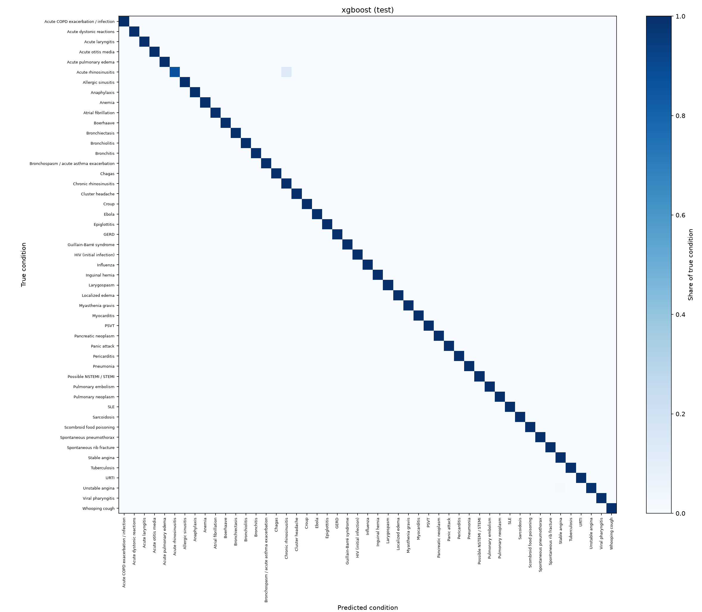
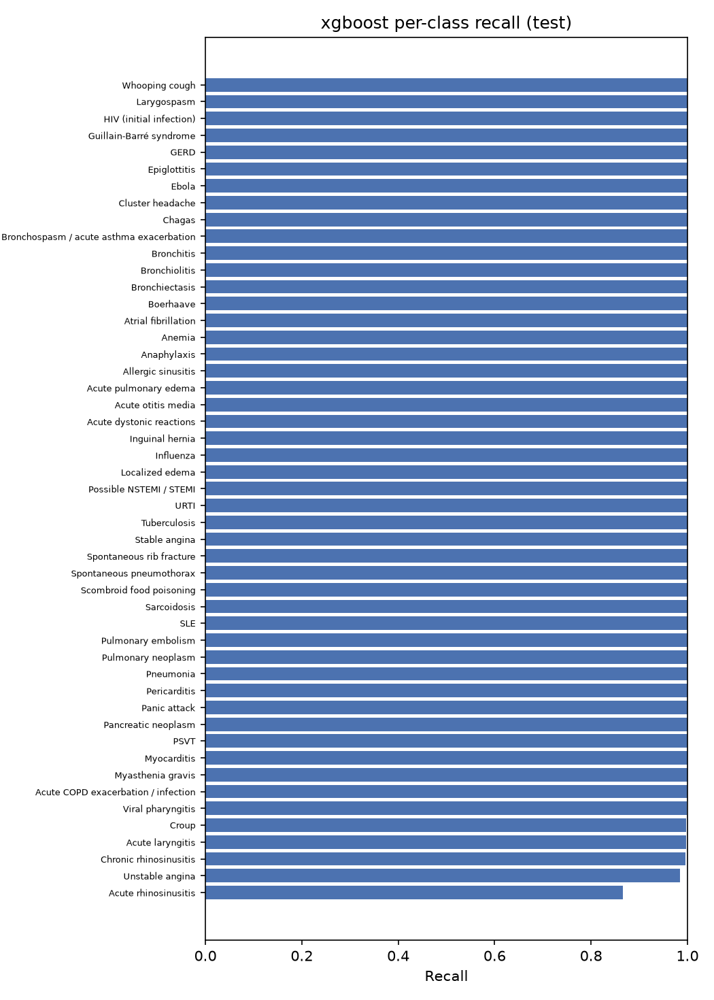

# Model comparison

> BeaconAI is decision support, not diagnosis. These models are trained only on synthetic data (DDXPlus) and are not a medical device.

Generated by `make eval` (or `make eval-val`). Do not edit by hand; analysis lives in `docs/phase2_analysis.md`.

Data: DDXPlus full dataset, 134,529 test patients.
Selection: best validation `top3_accuracy`. Selected model: **xgboost**.
Exact ties are broken by `top1_accuracy`, then `macro_f1`.

## Validation

| Model | Top-1 | Top-3 | Top-5 | Macro F1 | DDx nR@3 |
|---|---:|---:|---:|---:|---:|
| logreg | 0.996 | 1.000 | 1.000 | 0.994 | 0.701 |
| xgboost | 0.997 | 1.000 | 1.000 | 0.997 | 0.696 |
| mlp | 0.996 | 1.000 | 1.000 | 0.995 | 0.691 |

## Test

| Model | Top-1 | Top-3 | Top-5 | Macro F1 | DDx nR@3 |
|---|---:|---:|---:|---:|---:|
| logreg | 0.996 | 1.000 | 1.000 | 0.995 | 0.703 |
| xgboost | 0.998 | 1.000 | 1.000 | 0.997 | 0.697 |
| mlp | 0.996 | 1.000 | 1.000 | 0.996 | 0.693 |

## Differential overlap (test)

Overlap between our top-k and the DDXPlus reference differential D (conditions with non-zero probability). Precision@k = hits / k. Raw recall@k = hits / |D|, which stays below 1 whenever D has more than k conditions. Normalized recall@k = hits / min(k, |D|), so 1.0 means our k slots hold as many reference conditions as possible. Normalized recall@3 is the headline differential metric (DDx nR@3 above).

| Model | k | Precision@k | Recall@k (raw) | Recall@k (normalized) |
|---|---:|---:|---:|---:|
| logreg | 3 | 0.648 | 0.331 | 0.703 |
| logreg | 5 | 0.529 | 0.404 | 0.627 |
| xgboost | 3 | 0.642 | 0.317 | 0.697 |
| xgboost | 5 | 0.512 | 0.381 | 0.604 |
| mlp | 3 | 0.638 | 0.320 | 0.693 |
| mlp | 5 | 0.524 | 0.400 | 0.621 |

## Cost

| Model | Fit time (s) | Latency per patient (ms) | Params |
|---|---:|---:|---|
| logreg | 14.3 | 0.08 | `{"max_iter": 500, "solver": "lbfgs", "tol": 0.0001, "C": 10.0}` |
| xgboost | 183.7 | 0.99 | `{"n_estimators": 400, "early_stopping_rounds": 20, "tree_method": "hist", "subsample": 0.8, "colsample_bytree": 0.8, "learning_rate": 0.1, "max_depth": 4}` |
| mlp | 54.0 | 0.05 | `{"epochs": 30, "batch_size": 512, "patience": 3, "weight_decay": 1e-05, "dropout": 0.4, "hidden_sizes": [256], "lr": 0.001}` |

## Confusion matrix (xgboost, test)

Rows are normalised: each row shows where patients with that true condition were predicted.

### Most frequent confusions

| True | Predicted as | Count | Share of true | Severity (true / predicted) |
|---|---|---:|---:|---|
| Acute rhinosinusitis | Chronic rhinosinusitis | 245 | 0.134 | 4 / 5 |
| Unstable angina | Stable angina | 43 | 0.015 | 2 / 2 |
| Acute laryngitis | Viral pharyngitis | 11 | 0.003 | 4 / 4 |
| Viral pharyngitis | Acute laryngitis | 11 | 0.001 | 4 / 4 |
| Chronic rhinosinusitis | Acute rhinosinusitis | 10 | 0.004 | 5 / 4 |
| Croup | Larygospasm | 1 | 0.003 | 2 / 1 |

Severity is from DDXPlus `release_conditions.json` (1 is most severe).

### Lowest per-class recall

| Condition | Recall |
|---|---:|
| Acute rhinosinusitis | 0.866 |
| Unstable angina | 0.985 |
| Chronic rhinosinusitis | 0.996 |
| Acute laryngitis | 0.997 |
| Croup | 0.997 |
| Viral pharyngitis | 0.999 |
| Acute COPD exacerbation / infection | 1.000 |
| Acute dystonic reactions | 1.000 |
| Acute otitis media | 1.000 |
| Acute pulmonary edema | 1.000 |
